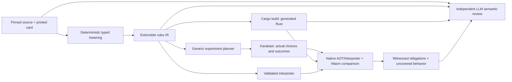

# Automatic card pipeline



Run from the repository root with Node 22 and normal engine/Rust/Wasm setup:

```sh
npm run cards:pipeline -- plan --cards TWI_124,TWI_170,JTL_052
npm run cards:pipeline -- run --cards TWI_124,TWI_170,JTL_052 --out /tmp/card-pipeline-run
npm run cards:pipeline -- review --run /tmp/card-pipeline-run --file /tmp/semantic-review.json
npm run cards:reference -- import --corpus /tmp/card-pipeline-run/reference
```

`run` requires a fresh directory. It compiles all source configuration, chooses the
requested cards, builds native and Wasm against that exact catalog, constructs
real-engine experiments, compares complete actions/states/results in three modes,
and tries deliberately wrong configurations. It produces a review packet; an
LLM still has to review it. The repository conversion skill supplies that stage
through Codex's independent reviewer. No model is called during compilation,
fixture construction, replay comparison, mutation testing or CI.

Output includes `catalog.json`, `executable-plan.json`, immutable `reference/`,
`check-*.json`, `dispatch-*/`, `report.json`, and `review/packet.json` plus complete
source artifacts. A failed run keeps a partial report with uncovered work. The
`review` command checks the packet digest, source artifact hashes, complete card
coverage, and explicit assessments of uncovered obligations before writing
`reviewed-report.json`. It does not authenticate an external model provider.

## Twenty-card work and validation

Keep card authoring and executable validation separate. `work init` creates up to
20 card jobs with full source, current plans and baseline file hashes. Each job
has its own temporary work directory. Workers claim the paths they will change;
overlapping file or directory claims are rejected. Shared runtime extensions
need one owner. Submit patches and evidence from the job directory, then integrate
reviewable changes before preparing a validation build. Submitting a job marks it
ready for validation; it does not mark a card correct or admitted.

```sh
npm run cards:pipeline -- work init --remaining --limit 20 --out /tmp/card-work
npm run cards:pipeline -- work status --run /tmp/card-work
npm run cards:pipeline -- work claim --run /tmp/card-work --job CARD_ID --worker author-a --paths bot/card-compiler/FILE.js
```

The claim response provides `workDir`, `token`, `bundlePath` and `handoffPath`.
Read the bundle and handoff, write a factual result JSON inside `workDir`, and put
any patch and test receipts there too. For example, a source-only result can state
`{"status":"source-inspected","cardId":"SET_NNN","findings":[],"remaining":["implementation","engine witnesses","independent review"]}`.
Omit `--paths` when claiming source-only work. Submit using the exact returned token:

```sh
npm run cards:pipeline -- work submit --run /tmp/card-work --job CARD_ID --worker author-a --token CLAIM_TOKEN --result result.json --patch change.patch --evidence checks.json
```

If a dependency blocks the job, release it instead of submitting:

```sh
npm run cards:pipeline -- work release --run /tmp/card-work --job CARD_ID --worker author-a --token CLAIM_TOKEN --reason "Dependency needs another owner" --blocked
```

Paths to submission files resolve within the claimed `workDir`; omit `--patch`
and `--evidence` for source-only work. Resume a blocked job with `work claim
--resume-blocked` after resolving its dependency. Retain source-only results as
unimplemented work even though their queue submission is ready for validation.

Use actual job IDs and paths from the queue. Claims have explicit ownership tokens;
release or submission requires the current token. Do not edit the shared checkout
from concurrent author jobs. Keep implementations in isolated work directories and
transfer their reviewed patches through the integrator. Queue state, worker
handoffs, patches and review receipts stay outside the repository.

Prepare native and Wasm once, then run up to 20 independent card processes:

```sh
npm run cards:pipeline -- prepare --out /tmp/card-build
npm run cards:pipeline -- fanout --prepared /tmp/card-build --cards CARD_IDS --jobs 20 --out /tmp/card-validation
npm run cards:pipeline -- fanout-status --run /tmp/card-validation
npm run cards:pipeline -- fanout --run /tmp/card-validation --jobs 20
```

Replace `CARD_IDS` with comma-separated printed IDs. Without `--prepared`, fanout
prepares one shared build itself. Normal preparation uses incremental Cargo caches
and copies binaries into an immutable bundle. Reuse that bundle while its inputs
remain unchanged. Freeze the canonical engine, compiler, runtime and pipeline
sources during preparation and validation; author patches can proceed elsewhere.
There must be one canonical build owner while preparation copies the warm native
and Wasm outputs. Each child runs the engine experiments, all three backend checks,
and mutation checks for one card. A prepared child never invokes Cargo or rebuilds
the engine. Each child's three backend checks run sequentially, so 20 card jobs do
not launch 60 runtime checks at once.

Failed cards retain their evidence and do not cancel successful siblings. Resume
rechecks completed artifacts and starts failed or interrupted jobs in fresh attempt
directories. `--timeout-ms` bounds each child, including its subprocesses. Only use
`--recover` after the previous coordinator has stopped; live owners cannot be
replaced. An interrupted lock acquisition or build-cache lock requires inspection
and manual cleanup after confirming no owner remains.

Passing comparisons stay `review-pending`; cards lacking a construction adapter
stay `needs-work`. The independent semantic review and ordinary reference import
steps still apply to every accepted card. Report elapsed validation time, peak
child count, reviewed cards and newly admitted cards separately. Existing-card
smoke tests and replays do not count as newly completed conversions. The number of
simultaneous model authors is bounded by the current session's available agent
slots; the subprocess limit does not create extra model sessions.

## Full rebuilds every 200 new cards

Use incremental builds and targeted engine comparisons between full checkpoints.
Initialize the counter once at the current reviewed admission baseline:

```sh
npm run cards:pipeline -- checkpoints init --out /tmp/card-progress --baseline-commit FULL_COMMIT_SHA
npm run cards:pipeline -- checkpoints record --run /tmp/card-progress --pipeline /tmp/card-run --before-commit BEFORE_SHA --integration-commit AFTER_SHA
npm run cards:pipeline -- checkpoints status --run /tmp/card-progress
```

Recording requires the actual packet-bound independent GPT-6.1 Sol review at high
or higher effort, completed three-backend comparisons, and committed implementation
and admission files matching the evidence. It counts unique admissions added by
the integrated change and absent from the initial baseline. Re-recording the same
card or replaying existing cards cannot advance the counter.

Each crossed 200-card boundary creates a pending full-check job bound to its exact
integration commit. The coordinator dispatches that job to a background subagent
with an isolated checkout, complete pinned engine setup and separate build target.
Use `prepare({out, full: true})` from that checkout for a fresh target, then run the
full accepted native/Wasm corpus and required full checks. This full preparation
uses its own output-directory lease and does not lock the ordinary warm cache.
Keep immutable logs and the tested revision with the result. Later integration
must not relabel that result as testing a newer revision.

The background agent investigates failures and prepares isolated fixes while card
authors continue. Integrate fixes through ordinary targeted checks and independent
review. The counter emits work; it does not launch model sessions or assert that a
pending full check passed. Checkpoint receipts and temporary progress state remain
outside the repository.

## The rules language and its extension boundary

`swu-card-ir/v1` is a domain language: typed expressions, explicit receiver and
selected-target bindings, selectors, costs, triggers, effects, ordered steps,
conditional branches, grouped event preparation and continuations. Cards remain
data. There is no card-ID switch or JavaScript callback running inside search.
Program content determines generated execution, with canonical bytes checked as
well as the content hash. Reprints and equivalent cards share executable content.

The language must be extendable to every card. The current operation set is not
that complete language yet. Add missing concepts as reusable typed primitives:
new zones and queries; explicit capture slots; arbitrary event subscriptions;
replacement/prevention stages; delayed effects with lifetime/cleanup; controlled
movement, ownership and copying; and event-result bindings. For each extension,
update source lowering, type/capability validation, interpreter semantics, AOT
lowering, experiment construction, and semantic review obligations. Unsupported
operations stay named rejections or explicit backend fallbacks. Storage limits
are runtime capacity choices to revise with evidence, not limits on which cards
can be represented by a future language version.

The first AOT backend emits executable Rust for scalar draw, damage, healing,
ready/exhaust, no-action and phase-stat operations with supported constant
expressions and step control. Shared engine primitives still manage targeting,
legal choices, commits, defeats and prompts. Dynamic expressions, grouped
operations and constant/live modifiers currently use their validated runtime
paths. Reports name these boundaries. A static table of instructions alone would
not count as generated execution; dispatch receipts show actual generated steps.

```sh
target/release/omni-rs rules --catalogue bot/card-compiler/generated/catalog.json
target/release/omni-rs check TRACE --pool POOL --catalogue CATALOG --backend interpreter
target/release/omni-rs check TRACE --pool POOL --catalogue CATALOG --backend auto --rules-receipt /tmp/dispatch.json
```

Auto selects generated code when the exact program was present at build time;
otherwise the report names the interpreter fallback. Interpreter bypasses the
new generated execution. Strict `aot` rejects any program in the selected pool
that requires fallback, including constants. `SWU_RULES_CATALOGUE=FILE` selects
the catalog at Cargo build time; the pipeline sets it for both binaries. There
is no runtime JIT, parser or scripting VM on the generated instruction path.
Instrumentation is opt-in and disabled for ordinary play/search/benchmarks.
Compilation is a performance opportunity, not an assurance of faster search;
compare equal-work search results and binary size when extending code generation.

## Experiments and coverage

The planner operates on rule structure. The initial construction vocabulary
handles simple targeted constant damage and phase stat events, standalone phase
stat and defeat events over filtered arena lists, self stat modifiers whose power
depends on damage, and bounded cost-query conditions for discard, upgrade defeat,
death-triggered ready and upgrade attachment. Scalar upgrade-return experiments
cover ordinary and token attachments, ownership across host controllers, discard
recovery, cost and uniqueness filters, base-trait conditions, optional decline,
and host death after losing an attachment HP bonus. On Defense experiments cover
attacker-owned trigger ordering, Restore, Saboteur removing specific Shields,
ordinary Ambush play, a captured defense trigger after lethal On Attack damage,
optional Experience, cross-arena unit choices, readiness and terminal own-base
damage. Initial attack stat deaths and nested ability-caused deaths also have
separate synthetic diagnostics; those are not printed-card reference witnesses.
Controller changes, multi-target attacks and token-entry aura deaths remain
explicit gaps for this family. It selects setup cards from metadata,
uses ordinary engine actions after a disclosed starting position, and records
oracle observations. Arena-list defeat experiments exercise global entry order,
death draws, reverse cleanup across multiple parents, token removal and eligible
leader undeployment. Arena-list stat experiments exercise mixed controllers and
arenas, empty sets, expiry and simultaneous lethal targets. Aura-dependent timing
and unconstructed interactions remain explicit gaps for each family. It does not compute expected game outcomes from the IR.
Positive targeting, ownership/arena differences, damaged and lethal targets,
bases, invalid hand targets, no eligible units, phase expiry, initial stat values
and live damage changes have construction adapters. Other shapes remain visible
as uncovered obligations. This is extensible experiment generation, not exhaustive
state-space exploration.

Hidden experiments distinguish ordinary play from arena placement, observe phase
expiry, and compare ordinary and Saboteur attack menus. Actual source programs
exercise grants to previously played versus staged units, trait/controller/arena
filters, grant-source departure, conditional base traits, intrinsic Raid and
Saboteur combat, defense returns with Overwhelm, death exhaustion, live resource
counts, Hidden queries after expiry and their three-target limit, and healing
continuations based on actual damage healed. Full states carry explicit phase
history for every arena unit. Keyword-only Hidden units use their complete printed
text and metadata as the source, with actual Shielded play and Raid, Grit, Restore,
Overwhelm, Saboteur and Ambush combat where those keywords are present.
Synthetic grant/removal, Sentinel, reentry and
history-import checks remain separate diagnostics; unconstructed leader/token
history and controller-change interactions stay explicit coverage gaps.

Arena-query experiments cover both source seats, friendly versus opposing units,
ground/space and offboard membership, physical-source exclusion, native unit
tokens and genuinely deployed leaders. Normal play distinguishes conditional
Ambush from late gain/loss/regain without another entry attack, and the exhaustion
query from its independently chosen target, optional decline and legal ineffective
choices. Front actions assert exact payment and cancellation, global three/four/
five-unit thresholds, one exhausted Spy with its real identity, and later Raid
combat. Real deployment, attack choices, paid defeat and self-lethal attacks retain
leader identity and stop departed attackers before combat. Shield consumption
checks exact attachment identity. Captured-source departure before query entry
resolution, competing trigger priority, controller/pilot interactions, arbitrary
callbacks and large-board interactions remain explicit gaps.

Base and leader-zone experiments construct genuinely different initial decks
for both source seats. They cover 26-HP versus ordinary 30-HP base lethality,
leader deployment, paid damage, a +HP survival boundary, exact attack damage,
and real undeployment preserving the leader identity. The two-sided Raid source
covers printed cost thresholds in both arenas, controller and physical source
exclusion, intrinsic stacking, later entrants, natural phase persistence, and
ordinary upgrade/native-token negatives. Different special bases together,
front exhaustion, blanking, control changes, piloting, general aura deaths and
unique-entry membership remain explicit gaps.

Arena token experiments cover both source seats, independent Shielded and play
trigger ordering, consumed Shields versus Shielded keyword presence, physical
source exclusion, unique replacement, paid source defeat, empty eligible lists,
later entrants, Rebel and damage filters, and selected native/deployed recipients.
Exact token identities, allocation-before-attachment, Experience stats and combat,
Sentinel attack menus, Shield consumption and native-token host cleanup are
asserted. Engine event hooks establish source-side batch topology separately from
native/Wasm action, state and result comparisons. Framework stat deaths, arbitrary
competing registrations, controller changes, ordinary-upgrade host cleanup and
unconstructed native/leader combinations remain explicit gaps.

Standalone arena-list phase keyword experiments cover Raid and Restore grants,
Hidden loss, controller/arena membership, entering sources, actual combat, later
arrivals, source departure, expiry, stacking two events, empty-event confirmation
and cancellation, and real token/deployed-leader recipients. Intrinsic numeric
stacking, recipient reentry, capped or ineffective Restore, Sentinel precedence,
and live Hidden regain remain explicit gaps. Capacity and overflow checks are
separate runtime tests.

Two-factory arena keyword experiments distinguish one handler per recipient
from independent child helpers in source order. Actual source cases cover both
source seats, empty payment/cancellation, trait/controller/arena membership,
Raid damage, Sentinel attack menus, and Saboteur gain/loss with exact surviving
Shield identities. On Attack Restore distinguishes the source declaration from
a later recipient attack, including capped and full-health healing. An actual
Sentinel-dependent HP aura, later damage and natural expiry witness defeat when
the keyword bonus ends. Stacking, later arrivals, source departure, reentry,
controller transfer, token/leader recipients and unavailable printed trait
overlap remain gaps for these four source programs.

Named-target experiments cover two independent optional unit selectors with
literal phase stats. They compare both owners, trait and arena filters, voluntary
declines, cancellation at each prepayment prompt, empty-event confirmation,
missing descriptors, entering-source eligibility, and natural phase expiry.
Selections prepare before event payment when available; a missing descriptor can
delay the remaining prompts until after payment. Effects wait for both choices.
Unique-source departure, recipient reentry, overlapping trait recipients, lethal
expiry, and token/deployed-leader interactions remain explicit coverage gaps.

Named On Attack phase-stat experiments normally play the source, wait for natural
readiness, then declare an attack. They cover mandatory and optional selectors,
both recipient controllers, arena restrictions, same-recipient stacking, zero
power clamping and phase expiry. Separate actual-source cases check lethal
recipient HP loss, captured defense and death triggers, attacker or defender
departure, and an ordinary upgrade granting Overwhelm before a defender departs.
A positive HP bonus can preserve a damaged recipient until natural expiry.
Same-recipient positive-then-negative HP proves deferral and stacking; it does
not distinguish an intermediate lethal sweep. Reversed source seats, unique
replacement, recipient reentry, broad token/leader combinations and framework
stat-death ordering remain explicit gaps.

Named unit-damage experiments normally play the source and preserve its chooser
through friendly and enemy selections. Both source seats, ground-only and
unrestricted unit domains, entering-source eligibility and missing enemies have
separate cases. Damage, Shield replacement and physical defeat wait for the
remaining selection. Paired Shields and captured death effects exercise both
owner priorities, exact surviving token identities and stable Force identity.
Actual Ambush accept/decline, unique replacement, natural readiness, captured
defense, defender departure and self-lethal damage preparation check attack
resumption. Ordinary attachment cleanup, repeated nonunique sources, reentry,
controller transfer, broad token/leader targets, gained Overwhelm and framework
aura deaths remain gaps. Ziton witnesses cover only the pinned two-player
implementation; its source explicitly disclaims accurate Twin Suns behavior.

Named ground-unit/base damage experiments normally play the space source and
wait for natural readiness. They cover both source seats, both base choices,
missing enemy ground recipients, owner/arena exclusions, one or two Shields,
lethal ground damage and original space-unit combat. Fatal own-base cases assert
the latched winner while the selected unit is defeated, its mandatory Force gain
resolves and combat completes. Unique replacement, source departure, token/leader
recipients, ordinary attachment cleanup, captured defense, gained Overwhelm and
controller transfer remain explicit gaps.

Opposite-chooser experiments cover normal unit/event play, both source seats,
missing domains and empty-event cancellation. They assert payment by the source
controller before the opponent chooses, both mandatory domains, deferred shared
damage/defeat, and original-actor replacement/death priority. Real cases cover
paired Shields, captured Force gains, unique-source keep-old/keep-new choices,
native Clone recipients and deployed-leader inclusion or exclusion. Defeat
checks ordinary and native attachment identity, detachment and destinations.
Control transfer/reentry, multiplayer, attack-time opposite choosers and broader
creation/replacement hooks remain gaps.

Mixed named-event experiments cover ready/damage, exhaust/cheap Shield and
Shield/negative power pairs. They distinguish truly empty domains from legal
but ineffective readiness choices, cancellation at either selection, delayed
payment, same/different recipients and controllers, and exact token allocation
after the final choice. Real Shields are consumed in later ordinary combat;
phase modifiers expire naturally. Fervor cases include prevention, captured
death effects, native attachment removal and ordinary attachments controlled
by the other player. Printed-cost boundaries include a native Beast and an
ineligible deployed leader. Reversed source seats, recipient departure during
selection, replacement/cancellation of token creation, controller transfer and
multiplayer remain gaps; attachment cleanup coverage is specific to Fervor.

Weakness experiments cover optional play/death registrations, both controllers,
damaged-only choices, exact resource thresholds, the entering source, signed
stat stacking and zero-power clamping, lethal HP loss, and native token/deployed
leader recipients. Creation and attachment observations preserve actual token
identity, recipient ownership and attachment order. Removing a negative HP
attachment cannot undo a defeat already captured. The native token adapter is
reviewed separately from the three printed source cards; its setup appearance
is not an ordinary token-play witness. Mixed attachment cleanup, removal/return,
replacement, and multiple-recipient or mixed-effect groups remain explicit gaps.

Ordinary-upgrade Weakness experiments use actual attachment and optional play
triggers. They cover hosts in both arenas and under both controllers, reversed
source seats, attachment cancellation, decline, own-host net stats, stacked
negative tokens and zero-power clamping. Exact payment, token identity, ownership
and append order are checked. A wounded ordinary unit and an HP-one native token
remain defeated after negative-attachment cleanup; a deployed leader is a valid
recipient. Existing Experience and Shield tokens exercise attachment order.
Mixed ordinary-attachment cleanup, later host combat, source departure, token
replacement and multiplayer remain explicit gaps.

Weakness continuation experiments cover conditional one/two-token events, mixed
damage and Weakness on play/death, Beast entry before a friendly selection, and
Weakness followed by unique-unit exhaustion. Both source seats exercise actual
empty-event payment/cancellation, Shield prevention, signed stat loss and lethal
recipients. Captured Inferno play/death registrations retain their physical source
through unique replacement. Normally played Snoke defeats an entering Picador
before its captured ability creates a Beast; that Beast remains a later target.
Actual Hevy death effects and Force-gain death registrations check continuations
after recipient departure. Recorder assertions retain token IDs, ownership and
allocation/attachment/death order. Other token replacement, controller changes
and unconstructed interactions remain explicit coverage gaps.

Friendly arena-list phase-stat experiments cover static trait filters and source
exclusion, mixed controllers and arenas, native token and deployed-leader
recipients, source departure, later arrivals, stacking, and empty-event payment
and cancellation. Actual damage while an HP bonus is active establishes survival
followed by defeat at natural phase expiry. Recipient reentry, later trait
changes, simultaneous expiry deaths, aura/attachment deaths, and matching
Creature leaders remain explicit gaps.

Force experiments cover gain, use, regain, already-held and absent tokens,
independent owners, optional decline, phase persistence, exact persistent token
identity and allocation, captured defeated-source continuations, and empty or
partial draw piles with fatigue. The first actual sources exercise draw-two,
self-ready and gain on ordinary-unit entry, including unique replacement. Native
token definitions are reviewed separately from printed-card play witnesses.
Further source experiments cover ordinary-unit play/death and event use before
scalar damage, healing, phase stats or opposing hand choice. They distinguish
absent Force and optional decline, prepayment event confirmation/cancellation,
post-use target selection, ineffective continuations, recipient deaths, Shield
prevention, and Shielded trigger ordering. Printed Overwhelm combat and Hidden
attack protection have their own witnesses.

Force-trigger experiments cover separate attack and defeat gain registrations,
including a lethal attack that captures both and an already-held token. Upgrade
experiments cover non-Vehicle attachment in both arenas, controller identity on
an enemy host, printed stat bonuses and aspect costs, both bases, partial and
capped healing, optional decline, and absent Force. Same-host unique upgrades
automatically lose the older copy; different hosts offer a choice, and a captured
When Played ability still heals after its source is defeated. Controller transfer,
attack cancellation, other simultaneous source triggers, replacement effects and
unit-host death after attachment remain explicit gaps.

Force-presence experiments cover actual gain/use/regain changing self Grit,
Sentinel attack menus and friendly power in both arenas. Enemy-only Force does
not activate these effects, and phase changes preserve them. Conditional Ambush
experiments cover both Shielded trigger orders, accept/decline, no enemy target,
and later Force gain without a retroactive attack. Actual Hidden grants test the
Sentinel exception as Force changes. Power-aura cases include a Beast token and
source departure. Deployed-leader membership and pending-window Force loss have
separate runtime diagnostics; controller transfer, unique replacement, reentry
and aura stacking remain explicit gaps. Other Force queries, hooks, costs,
groups and continuations remain uncovered or runtime-rejected; passing these
experiments does not establish them.

Force continuation experiments cover optional Force spending before a bounded
arena defeat wave or an up-to-five Shield selection, plus damage followed by
Force gain. Both source seats distinguish the live Sith/remaining-HP filter,
Force-loss stat deaths, captured death effects and owner ordering, Shield
prevention, empty event commitment without confirmation and captured play abilities
after unique replacement. Exact selector titles, selected-card toggles, the
five-card limit, persistent Force identities and ordered native Shield creation
are asserted. Actual Restore attacks include capped and full-health healing.
Beast wave membership, repeated Drain copies, natural Shield phase persistence,
nonlethal Sentinel-dependent HP refresh, controller transfer, reentry and broader
token replacement remain explicit gaps.

Parent-upgrade experiments cover normal attachment and prepayment cancellation,
printed stats, Creature/Force and Heroism predicates, both source seats and host
controllers, and both arenas. Positive unselected units distinguish the actual
parent from any matching unit. Beast creation uses the caster; Shield ownership
uses the host controller, including additive Shields, native unit-token hosts and
a deployed leader. Actual Torrent followed by an ordinary upgrade return exercises
HP-loss defeat and attachment cleanup. Parent title evaluation is observed through
the actual ability context; competing title menus, detached captured play,
reattachment, controller transfer, host uniqueness reactions, natural phase
persistence and further token replacements remain explicit gaps.

Keyword-inventory experiments distinguish current keyword names from numerical
amounts, inactive effects and metadata mentions. Both seats exercise an optional
exhaustion selector and an aura for other friendly units, including live Raid 0,
inactive Coordinate, consumed Shielded, repeated numeric grants, phase expiry,
keyword loss and resulting HP defeats. Normal source play, unique replacement,
source departure, later entrants, native Beast and deployed-leader recipients
preserve membership and physical identity. Real Force gain/use/regain checks
cached HP boundaries and damage that becomes lethal before a later Force gain.
Coordinate metadata, values and printed registration counts must agree. Further
controller transfer, keyword replacements/blanking, cost-bearing instances,
Hidden history expiry, competing death triggers and capacity remain uncovered;
token/leader selection and live phase changes in the exhaustion selector remain
separate from the aura witnesses.

Conditional arena-damage experiments cover normal source play, both source seats,
live own-unit counts and own-base damage thresholds, ground/space membership,
empty recipient lists and exact damage. Unique replacement checks both physical
copies and post-removal counts; a captured play ability can resolve after its
source leaves. Native unit tokens and deployed leaders contribute to the count.
Natural readiness, printed Restore and Raid, normally attached Devotion and both
Restore/wave orders exercise live declaration conditions. Exact Shield identities,
a surviving unit defender, two successive Shield replacements and captured
mandatory defense/death effects check attack continuation. Controller transfer,
late entry during replacement, source departure during a Shield prompt, arbitrary
competing death orders, gained Overwhelm and further aura interactions remain
explicit gaps. Capacity and pending-window threshold changes have separate
runtime diagnostics.

Self-resource experiments cover real event play and ordinary-unit defeat, both
controllers, optional decline, own/absent/enemy Force, exact paid cost, exhausted
entry, persistent card identity, repeated copies and natural phase readiness.
Wounded sources with ordinary and native attachments exercise real defeat cleanup
before movement. Event observations establish discard entry before the same card
becomes a resource. Earlier death-time return to hand and the live discard guard's
negative branch remain explicit printed-card gaps; current-zone movement,
already-resource readiness and destination capacity have separate runtime tests.

An obligation moves from generated to oracle-exercised only after its construction
and observation assertions pass, then to matched only when the same trace, pool
and catalog agree in native Auto, native Interpreter and Wasm Auto. Deliberately
wrong amounts, target restrictions, list scopes, signs, cost predicates, departure
destinations, optionality and condition branches test
the sensitivity of these experiments. Rejected mutants do not count as detected gameplay errors; surviving
mutants become uncovered obligations. Passing mutants tests only those mutations.

IR-derived tests cannot detect every source behavior omitted by the compiler.
The reviewer must independently compare printed text, full card and helper source,
configuration, generated code, runtime helpers and gaps. Unexercised Shield,
attachment, deployed-leader, aura/death timing and source-completeness obligations
remain explicit for the initial pilot. Distinguish an incorrect Karabast baseline
from a conversion error and from a Rust error. Finite traces and an LLM review
remain evidence with limits, not a proof for every interaction.

New automatic recordings retain their immutable construction definition in the
reference manifest. Accepted traces run in native and Wasm CI without regenerating
the oracle. The existing manual semantic cases remain useful for interactions
that do not yet have a general construction adapter.
