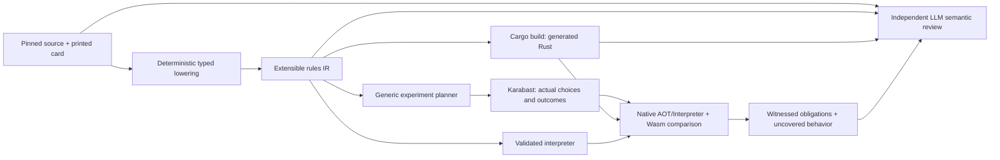

# Automatic card pipeline



Run from the repository root with Node 22 and normal engine/Rust/Wasm setup:

```sh
npm run cards:pipeline -- plan --cards TWI_124,TWI_170,JTL_052
npm run cards:pipeline -- run --cards TWI_124,TWI_170,JTL_052 --out /tmp/card-pipeline-run
npm run cards:pipeline -- review --run /tmp/card-pipeline-run --file /tmp/semantic-review.json
npm run cards:reference -- import --corpus /tmp/card-pipeline-run/reference
```

`run` requires a fresh directory. It compiles all source configuration, chooses the
requested cards, builds native and Wasm against that exact catalog, constructs
real-engine experiments, compares complete actions/states/results in three modes,
and tries deliberately wrong configurations. It produces a review packet; an
LLM still has to review it. The repository conversion skill supplies that stage
through Codex's independent reviewer. No model is called during compilation,
fixture construction, replay comparison, mutation testing or CI.

Output includes `catalog.json`, `executable-plan.json`, immutable `reference/`,
`check-*.json`, `dispatch-*/`, `report.json`, and `review/packet.json` plus complete
source artifacts. A failed run keeps a partial report with uncovered work. The
`review` command checks the packet digest, source artifact hashes, complete card
coverage, and explicit assessments of uncovered obligations before writing
`reviewed-report.json`. It does not authenticate an external model provider.

## The rules language and its extension boundary

`swu-card-ir/v1` is a domain language: typed expressions, explicit receiver and
selected-target bindings, selectors, costs, triggers, effects, ordered steps,
conditional branches, grouped event preparation and continuations. Cards remain
data. There is no card-ID switch or JavaScript callback running inside search.
Program content determines generated execution, with canonical bytes checked as
well as the content hash. Reprints and equivalent cards share executable content.

The language must be extendable to every card. The current operation set is not
that complete language yet. Add missing concepts as reusable typed primitives:
new zones and queries; explicit capture slots; arbitrary event subscriptions;
replacement/prevention stages; delayed effects with lifetime/cleanup; controlled
movement, ownership and copying; and event-result bindings. For each extension,
update source lowering, type/capability validation, interpreter semantics, AOT
lowering, experiment construction, and semantic review obligations. Unsupported
operations stay named rejections or explicit backend fallbacks. Storage limits
are runtime capacity choices to revise with evidence, not limits on which cards
can be represented by a future language version.

The first AOT backend emits executable Rust for scalar draw, damage, healing,
ready/exhaust, no-action and phase-stat operations with supported constant
expressions and step control. Shared engine primitives still manage targeting,
legal choices, commits, defeats and prompts. Dynamic expressions, grouped
operations and constant/live modifiers currently use their validated runtime
paths. Reports name these boundaries. A static table of instructions alone would
not count as generated execution; dispatch receipts show actual generated steps.

```sh
target/release/omni-rs rules --catalogue bot/card-compiler/generated/catalog.json
target/release/omni-rs check TRACE --pool POOL --catalogue CATALOG --backend interpreter
target/release/omni-rs check TRACE --pool POOL --catalogue CATALOG --backend auto --rules-receipt /tmp/dispatch.json
```

Auto selects generated code when the exact program was present at build time;
otherwise the report names the interpreter fallback. Interpreter bypasses the
new generated execution. Strict `aot` rejects any program in the selected pool
that requires fallback, including constants. `SWU_RULES_CATALOGUE=FILE` selects
the catalog at Cargo build time; the pipeline sets it for both binaries. There
is no runtime JIT, parser or scripting VM on the generated instruction path.
Instrumentation is opt-in and disabled for ordinary play/search/benchmarks.
Compilation is a performance opportunity, not an assurance of faster search;
compare equal-work search results and binary size when extending code generation.

## Experiments and coverage

The planner operates on rule structure. The initial construction vocabulary
handles simple targeted constant damage and phase stat events, standalone phase
stat and defeat events over filtered arena lists, self stat modifiers whose power
depends on damage, and bounded cost-query conditions for discard, upgrade defeat,
death-triggered ready and upgrade attachment. Scalar upgrade-return experiments
cover ordinary and token attachments, ownership across host controllers, discard
recovery, cost and uniqueness filters, base-trait conditions, optional decline,
and host death after losing an attachment HP bonus. On Defense experiments cover
attacker-owned trigger ordering, Restore, Saboteur removing specific Shields,
ordinary Ambush play, a captured defense trigger after lethal On Attack damage,
optional Experience, cross-arena unit choices, readiness and terminal own-base
damage. Initial attack stat deaths and nested ability-caused deaths also have
separate synthetic diagnostics; those are not printed-card reference witnesses.
Controller changes, multi-target attacks and token-entry aura deaths remain
explicit gaps for this family. It selects setup cards from metadata,
uses ordinary engine actions after a disclosed starting position, and records
oracle observations. Arena-list defeat experiments exercise global entry order,
death draws, reverse cleanup across multiple parents, token removal and eligible
leader undeployment. Arena-list stat experiments exercise mixed controllers and
arenas, empty sets, expiry and simultaneous lethal targets. Aura-dependent timing
and unconstructed interactions remain explicit gaps for each family. It does not compute expected game outcomes from the IR.
Positive targeting, ownership/arena differences, damaged and lethal targets,
bases, invalid hand targets, no eligible units, phase expiry, initial stat values
and live damage changes have construction adapters. Other shapes remain visible
as uncovered obligations. This is extensible experiment generation, not exhaustive
state-space exploration.

Hidden experiments distinguish ordinary play from arena placement, observe phase
expiry, and compare ordinary and Saboteur attack menus. Actual source programs
exercise grants to previously played versus staged units, trait/controller/arena
filters, grant-source departure, conditional base traits, intrinsic Raid and
Saboteur combat, defense returns with Overwhelm, death exhaustion, live resource
counts, Hidden queries after expiry and their three-target limit, and healing
continuations based on actual damage healed. Full states carry explicit phase
history for every arena unit. Keyword-only Hidden units use their complete printed
text and metadata as the source, with actual Shielded play and Raid, Grit, Restore,
Overwhelm, Saboteur and Ambush combat where those keywords are present.
Synthetic grant/removal, Sentinel, reentry and
history-import checks remain separate diagnostics; unconstructed leader/token
history and controller-change interactions stay explicit coverage gaps.

Standalone arena-list phase keyword experiments cover Raid and Restore grants,
Hidden loss, controller/arena membership, entering sources, actual combat, later
arrivals, source departure, expiry, stacking two events, empty-event confirmation
and cancellation, and real token/deployed-leader recipients. Intrinsic numeric
stacking, recipient reentry, capped or ineffective Restore, Sentinel precedence,
and live Hidden regain remain explicit gaps. Capacity and overflow checks are
separate runtime tests.

An obligation moves from generated to oracle-exercised only after its construction
and observation assertions pass, then to matched only when the same trace, pool
and catalog agree in native Auto, native Interpreter and Wasm Auto. Deliberately
wrong amounts, target restrictions, list scopes, signs, cost predicates, departure
destinations, optionality and condition branches test
the sensitivity of these experiments. Rejected mutants do not count as detected gameplay errors; surviving
mutants become uncovered obligations. Passing mutants tests only those mutations.

IR-derived tests cannot detect every source behavior omitted by the compiler.
The reviewer must independently compare printed text, full card and helper source,
configuration, generated code, runtime helpers and gaps. Unexercised Shield,
attachment, deployed-leader, aura/death timing and source-completeness obligations
remain explicit for the initial pilot. Distinguish an incorrect Karabast baseline
from a conversion error and from a Rust error. Finite traces and an LLM review
remain evidence with limits, not a proof for every interaction.

New automatic recordings retain their immutable construction definition in the
reference manifest. Accepted traces run in native and Wasm CI without regenerating
the oracle. The existing manual semantic cases remain useful for interactions
that do not yet have a general construction adapter.
