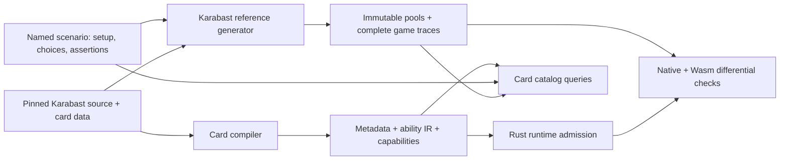

# Cards, behaviors, and reference tests

This is the entry point for finding a card, understanding its compiled behavior,
and locating or generating its tests. Stable card IDs and named behavior cases
are the organizing units. Work batches and review journals are not repository data.



## Browse

Run from the repository root, using Node 22:

```sh
npm run cards -- summary
npm run cards -- show TWI_124
npm run cards -- behavior phase-stats
npm run cards -- behaviors
npm run cards:reference -- list --card TWI_124 --include-setup
npm run cards:reference -- list --behavior phase-stats
```

`show` joins the compiler's authoritative metadata and IR with current admission
and test links. It reports compiler diagnostics even when a card is unsupported.
`behaviors` exposes both emitted IR capabilities and named semantic test families.
A capability describes what was compiled; it is not a claim that every printed
behavior of an unsupported card has been understood.

Tests distinguish **focus**, **setup**, **play**, and **diagnostic** evidence.
Focus cards are explicitly declared by the scenario or its annotations. A card
merely drawn or present in a random continuation does not become a focus card.
A play witness checks the engine's `onCardPlayed` event; it does not prove all
abilities. Historical recordings remain labeled as imported, with incomplete
original generator provenance. Current scenario assertions are not retroactively
claimed for those recordings. Cases without recordings remain visible.

## Generate from Karabast

Use the normal engine dependencies/card data from `npm run setup`. A source archive
or isolated engine is also usable when `forceteki/server` and `forceteki/build`
resolve to the same engine directory with its package/build scripts available.
The generator builds clean engine output when its cached build receipt is absent
or no longer matches the source/config/output hashes. It does not edit engine source.
The generated trace records source, build, data, fixture, chooser and exporter
hashes. Git revision is null for an engine archive; the expected submodule revision
is recorded separately rather than presenting the surrounding repo's HEAD as the engine.

```sh
npm run cards:reference -- generate \
  --case phase-stats/zero-power-from-pain \
  --out /tmp/zero-power-reference
npm run cards:reference -- generate \
  --case card-play/TWI_124 --out /tmp/twi-124-play
```

Select one case, a focused card (`--card`), or a behavior (`--behavior`).
`--include-setup` also selects cases where a card is only part of construction.
`--seed N` reproduces a selected random continuation; otherwise a stable case-ID
seed is used. Output must be a new directory. A failed assertion stops generation;
no complete manifest is written and nothing is imported into the accepted corpus.

By default generation uses the current admitted pool. `--pool FILE` selects an
exact existing pool. `--engine-only` extends that pool with the selected scenario's
card definitions so reference work can precede Rust support. Such output remains
unassessed until checked. Leaders and bases need explicit setup scenarios.
`--diagnostics` explicitly enables synthetic registration experiments; those are
labeled and never counted as printed-card evidence.

## Compare and accept

```sh
cargo build --locked --release -p omni-rs
npm run wasm:build -- --target node
npm run cards:reference -- check --corpus /tmp/zero-power-reference \
  --receipt /tmp/zero-power-check.json
npm run cards:reference -- import --corpus /tmp/zero-power-reference
npm run cards:reference -- verify
```

`check` defaults to both runtimes, compares every legal-action set, action-window
state and terminal outcome, and records the catalog/binary/Wasm package hashes.
Use `--native FILE` for another freshly built binary, or `--runtime native|wasm`
for a narrower development check. Filters work on checking as on generation.
The receipt must be a new file. `import` checks **all** incoming recordings in
both runtimes before adding them to the accepted corpus; it never overwrites an
existing content-addressed trace. Rebuild after runtime changes. A passing trace
is finite evidence, not a proof of every possible interaction.

Both Rust `reference_conformance.rs` and Wasm `reference-conformance.test.js`
consume this manifest in CI. The smaller original strict-pool and initial
compiled-runtime integration suites remain separate because they exercise those
loading modes. CI reads committed references; it does not need to build Karabast
or regenerate expected answers to compare the current runtime.

## Add or change a case

1. Add a named scenario to `reference/scenarios/<behavior>.js`. Each module exports
   `scenarios` and `fixture(env, pool, scenario, seed)`. Prefer an existing fixture
   constructor; a distinct constructor is appropriate for a distinct setup shape.
2. Declare `actualScriptedCardIds` and `actualTriggeredCardIds` only for the cards
   whose behavior is asserted. Define the semantic `family`, setup, scripted
   choices, and assertions from the pinned engine source before comparing Rust.
   Existing callback assertions run inside the fixture. An optional module-level
   `assertRecording(scenario, {records, witness})` checks the completed trace.
3. Run `npm run cards:reference -- index`. This regenerates `cases.json` and
   `behaviors.json`; `annotations.json` preserves explicit focus labels for older
   definitions. Indexing requires the engine build; ordinary browsing and CI do not.
4. Generate a fresh directory, inspect its witness, compare both runtimes, then
   import. Positive, boundary and interaction cases should distinguish plausible
   wrong implementations. Keep source conversion and runtime admission independent.

`fixtures/manifest.json.gz` (or legacy `manifest.json`) maps case IDs to immutable recordings. Pool and compressed
trace filenames are their SHA-256 values. The verifier checks file inventory,
bytes, metadata, scenario identity, seed, decision/window counts and completion.
Absolute paths inside older trace headers are historical; checking always passes
the content-addressed pool explicitly. A new recording supplements an old one;
retiring a regression is an explicit manifest change, not an accidental overwrite.
Readers require exactly one manifest format and reject ambiguity or damaged gzip.
The v1 document is unchanged; gzip reduces storage, not parsed memory. New corpora
use gzip, while imports preserve the destination format and append unique rows
in incoming order after existing rows. Manifest writes use an atomic rename in
the same directory. Cadence evidence copies and hashes the actual manifest file
and verifies the copied corpus; the 200-card review cadence is unchanged.

## Automatic configuration, experiments, and semantic review

Use the [automatic pipeline](PIPELINE.md) to compile configuration, construct
experiments from rule shapes, record the pinned engine, compare native generated
Rust, native interpreted rules and Wasm, and test experiment sensitivity with
mutated configurations. The output includes per-obligation uncovered behavior
and a source-bound packet for independent LLM review. `cards show SET_NNN` also
lists planned automatic cases and remaining construction gaps. Passing ordinary
reference checks alone does not complete semantic review.
