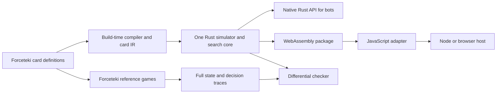

# Rust simulator and endgame prover

`omni-rs` is a deterministic, perfect-information rules library and command-line prover for an explicit Star Wars
Unlimited card subset. The existing match runner still uses forceteki. Setup and mulligans happen in that engine;
Rust starts at the first action window with both hands and both deck orders known.

The library is the starting point for a Rust backend: game transitions and search do not call JavaScript. The
trace tools use JavaScript to obtain reference decisions and states from the pinned engine. Extending the card
pool requires implementing and checking the new rules; unsupported cards are errors.

The same core is now available as a [WebAssembly package and JavaScript adapter](../omni/wasm/README.md).
It keeps persistent state, checkpoints, and complete searches inside Wasm, with Node and browser loaders.
The [card compiler](../card-compiler/README.md) lowers supported forceteki TypeScript definitions into data-only
card programs consumed by the same Rust core. Source conversion and executable support are reported separately;
the generated catalog includes explicit rejection reasons for rules that are not implemented.



Native bots can link the library directly; they do not need a WebAssembly boundary. A prospective upstream
Karabast integration can use the Wasm package from Node or a browser while retaining its existing UI. This is
an integration path, not a claim of upstream compatibility: setup, mulligans, hidden-information views,
the complete card catalog and forceteki's object API are not all supplied here. The adapter uses explicit
snapshots and stable action keys. Keep browser searches in a Worker so a synchronous proof does not block UI input.

## Generated card programs

```sh
npm run cards:compile
npm run cards:test
npm run cards:check
target/release/omni-rs catalogue bot/card-compiler/generated/catalog.json
target/release/omni-rs check trace.jsonl.gz --catalogue bot/card-compiler/generated/catalog.json --pool bot/card-compiler/generated/runtime-pool.json
```

The generated pool is an admission manifest, not evidence that every admitted card has been played. The compiler
coverage report separates complete source-AST conversion from metadata-only plain and keyword cards. The runtime
report validates all executable operations and separately labels reviewed native token adapters. Both native and
Wasm execute the same accepted programs; no TypeScript callback runs inside search.

## Build and reference data

Use Node 22 and the repository's setup instructions. `forceteki/build/server` and `forceteki/test/json` are required
for the reference tools. The Rust workspace shares the existing loader in `bot/rust/src/cards.rs`.

```sh
cargo build --release -p omni-rs
cargo test --workspace
node bot/omni/rs/make-pool.js
```

The committed pool includes a reason for every card. It selects plain 30 HP bases, Sabine Wren (`SOR_014`),
Darth Vader (`IBH_053`), Satine Kryze (`SEC_005`), keyword-only or textless units, and Shield tokens. Accepted
keywords are Sentinel, Raid, Overwhelm, Saboteur, Restore, Ambush, Grit, and Shielded. Numeric keyword values come
from the rules text. Every leader/base pair must have enough eligible cards for a 50-card deck.

The default 100-card pool excludes events, ordinary upgrades and other leader abilities. The generated-IR path
adds admitted action, event and triggered programs; its exact supported set is in the generated runtime report.
The generated path also supports bounded phase stat modifiers, static conditional stat auras, arena queries,
return-to-hand effects and resource readiness. Other lasting effects, Piloting, Bounty, Smuggle, Exploit,
Coordinate, random effects, shuffle effects, capture and control changes still require additional rules.
Satine's single-target healing distribution is explicit:
choosing the amount is part of the game tree.

## Proof meaning

A result of `p1` or `p2` means that side can force a win within the reported number of action windows, for this
supported rules subset. Both players' action windows consume depth. Follow-up prompts are choices as well.
At simultaneous regroup resource choices, the prover chooses first and the defender can respond after seeing
that choice. This gives the defender additional information and keeps a winning proof conservative.

`null` means no forced winner was found within the requested horizon and budget. It is not a proof of a draw.
`complete: false` means the search exhausted its budget. A proof discovered before exhaustion remains complete.
For an incomplete result, `depth` is the last iteration completed for both candidate winners. A complete `null`
only rules out a forced win within the requested depth. Budgets are cumulative across iterative depths and both
candidate winners, with the side to move tried first.

The simulator preserves every engine prompt, including cancellation and rejected clicks, for differential replay.
The prover normalizes uncommitted cancellation, rejected clicks, and finite UI-selection cycles to eventual
committed game choices. Repeatedly opening and cancelling an attack is not treated as a way to escape a forced
loss. All consequential choices remain branches, including unique defeat choices, trigger order, targets, optional
abilities, and Satine's zero/one/two healing allocations. The transposition table checks full state equality as
well as the Zobrist key; results depending on the current prompt-cycle path are not cached.

The JavaScript prover has a different move model: deeper prompts and regroup choices follow heuristic defaults.
Comparing its winner labels to Rust is useful, but agreement alone does not establish correctness. Differential
replay checks the independent Rust transitions against the reference engine.

## Reproducible measurements

The report joins results by `(game, i)` and rejects duplicate identities. Missing Rust results remain visible.
Games without any proven window count as zero in the mean horizon. The horizon is the greatest distance from the
recorded game's end at which a forced winner is found; it is not a prediction that imperfect bots will follow
the winning line.

```sh
# Generate the 300-game corpus, 75 games per pairing.
for bots in random,random heuristic,heuristic aggro,control tempo,rush; do
  node bot/omni/rs/trace.js --pool bot/omni/rs/pool.json --bots "$bots" --seeds 1-75 --out replays/omni-rs-corpus --gzip
done
target/release/omni-rs check replays/omni-rs-corpus/*.jsonl.gz
node tools/omni-rs-report.js coverage bot/omni/rs/pool.json replays/omni-rs-corpus replays/omni-rs-coverage.json

# Generate the 16 JS endgames, then replay/export exactly those deals.
for bots in aggro,control tempo,rush; do
  node bot/omni/solve-games.js --pool bot/omni/rs/pool.json --bots "$bots" --seeds 101-108 --budget 2000 --stop 2 --sample 0 --out replays/omni-rs-solve
done
node bot/omni/export-positions.js replays/omni-rs-solve replays/omni-rs-positions.jsonl --pool bot/omni/rs/pool.json
node tools/omni-rs-report.js prepare replays/omni-rs-solve replays/omni-rs-positions.jsonl replays/omni-rs-matched.jsonl
target/release/omni-rs prove replays/omni-rs-matched.jsonl --depth 12 --ms-field jsMs > replays/omni-rs-proofs.jsonl
node tools/omni-rs-report.js compare replays/omni-rs-matched.jsonl replays/omni-rs-proofs.jsonl replays/omni-rs-comparison.json

# A fixed budget also works; output is one JSON result per position.
target/release/omni-rs prove replays/omni-rs-matched.jsonl --depth 12 --nodes 100000
target/release/omni-rs prove replays/omni-rs-matched.jsonl --depth 12 --ms 2000

# Three independent, single-thread throughput runs used below.
for fixture in heuristic-vs-heuristic-1 heuristic-vs-heuristic-2 random-vs-random-1; do
  target/release/omni-rs bench "bot/omni-rs/tests/fixtures/$fixture.jsonl.gz" --nodes 1000000
done
```

`check` initializes Rust only once per trace and compares every subsequent legal action set, full action-window
state, and terminal state. It validates pool hashes and sequence receipts and stops at the first difference with
both sides and a field-level diagnostic. [Trace schema and canonical action identity](../omni/rs/README.md).

## Original 100-card results, 2026-10-11

These historical measurements precede the generic card-program interpreter. The separate
[fresh Wasm comparison](../../results/omni-wasm-1/README.md) records its exact measured commit as well.
Neither report measures the expanded catalog.

Measured on one Apple M5 Max, macOS 26.5.2 arm64, Node 22.22.3, Rust/Cargo 1.98.0, release profile, one thread.
Reference engine: `2be4fcdb4325346bb4a1ba14b29d4f66a1093e2a`. The exact 100-card pool hash and all counts are in
[summary.json](../../results/omni-rs-1/summary.json).

### Correctness and coverage

| Pairing | Seeds | Games | Decisions | Action windows | Mismatches |
|---|---|---:|---:|---:|---:|
| random,random | 1–75 | 75 | 30,375 | 11,549 | 0 |
| heuristic,heuristic | 1–75 | 75 | 8,883 | 4,674 | 0 |
| aggro,control | 1–75 | 75 | 8,418 | 4,391 | 0 |
| tempo,rush | 1–75 | 75 | 9,928 | 5,335 | 0 |
| Total | | 300 | 57,604 | 25,949 | 0 |

[Every pool card's played, attacked, and defeated counts](../../results/omni-rs-1/coverage.md) and
[per-trace checks](../../results/omni-rs-1/check-results.jsonl) are committed. Mae (`HMW_055`) never appeared in the
ordinary corpus because the dealer cannot fit her three aspects into these leader/base pairs. Imperial Venator
(`HMW_069`) appeared, was played, and attacked, but was never defeated. These are coverage gaps, not passed cases.
Additional targeted fixtures exercise Mae, missing-aspect costs, both unique choices, Ambush/Shielded ordering,
and Vader's winner latching when both bases die in one attack. All six committed fixtures total 121,908 bytes;
the 300-game corpus stays local. No engine exceptions occurred in the measured 300 games or 16 JS endgames.

### Speed

| Work measured | Nodes | Time per node | Relative to measured JS prover |
|---|---:|---:|---:|
| JS endgame prover | 96,002 | 4.660 ms | 1× |
| Rust complete-window simulator benchmark | 3,000,000 | 3.727 µs | 1,251× |
| Rust endgame prover, including search overhead | 2,661,230 | 4.685 µs | 995× |

Each number is total elapsed time divided by total nodes. Rust's three simulator runs measured 3.647, 3.753,
and 3.780 µs/window (about 268,000 windows/second combined). The benchmark includes all intervening prompts and
hashing, and excludes loading/parsing; it does not include proof branching or transposition-table overhead.
State is a 4,670-byte fixed-size `Copy` value. Both Rust measurements clear the 40 µs target. The actual JS subset
prover here is faster than the task's historical 38 ms/node baseline; the table uses the fresh same-machine run.
The two provers count action-window work but search different trees, so their node costs are not identical work.

### Horizon under matched elapsed-time budgets

| Prover | Games | Attempted windows | Proven windows | Mean greatest distance from end | Maximum distance |
|---|---:|---:|---:|---:|---:|
| JS, depth limit 8 | 16 | 103 | 66 | 4.4375 | 10 |
| Rust, depth limit 12 | 16 | 103 | 102 | 6.375 | 12 |

JS ran eight seeds per pairing with `--budget 2000 --stop 2`. That budget counts nodes cumulatively per window's
solve, across depths and candidate winners. Rust receives
the **actual elapsed JS time for each window**, not a blanket 2,000 ms. The mean improvement is 1.9375 recorded
windows. Rust proves the earliest sampled window in 15/16 games, so this result is a lower bound on its reach in
this sample: the experiment stops where JS stopped. The maximum distance of 12 is not a 12-window proof; the
longest successful Rust proof depth in this run was 7. [Per-game horizons](../../results/omni-rs-1/agreement.md).

### Winner agreement

| Comparison | Windows |
|---|---:|
| Both provers found a winner | 66 |
| Same winner | 66 |
| Disagreements | 0 |
| Rust result missing | 0 |

[All 66 pairs of winner labels](../../results/omni-rs-1/agreement.md) and
[all 103 Rust results with budgets](../../results/omni-rs-1/proof-results.jsonl) are committed. The only Rust
unknown was `aggro-vs-control-108`, window 64, eight windows from the end, after its 6,859 ms budget. No observed
disagreements need explaining; future ones can arise because Rust lets a defender choose a reply that JS's
heuristic follow-ups never tried.

## Regression checks and remaining scope

`cargo test --workspace`: 69 tests. `npm test`: 155 tests. `node bot/protocol-test.js`: 13 checks.
`npm run gate`: seeds 1–3 retain 594/342/486 steps and p2 wins, recorded and unrecorded. The four existing Rust bot
smoke games, analysis tests, and both viewer builds passed. Engine tracked source and pin are unchanged.
Advisory `npm run lint` was attempted once after committing; Perch could not run because `PERCH_API_KEY` was unset.

The current match runner, setup/mulligans, and full card engine remain in JavaScript. This crate provides the
independent Rust transition/search core for the subset; wiring it into `rust-search`, broader card rules,
hidden information, and parallel search remain separate work. The Wasm adapter is available for this same subset;
it does not expose the full forceteki object graph.
